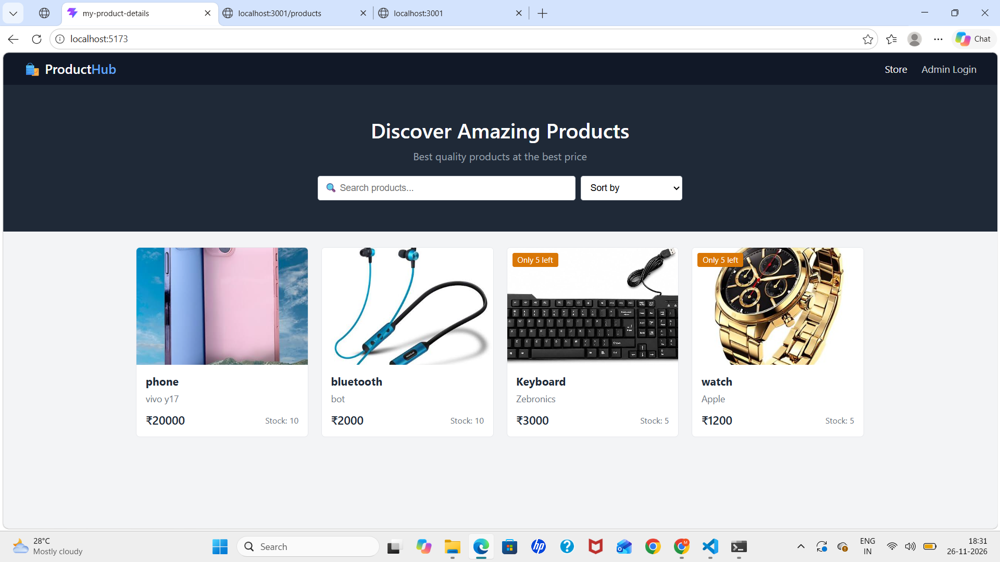
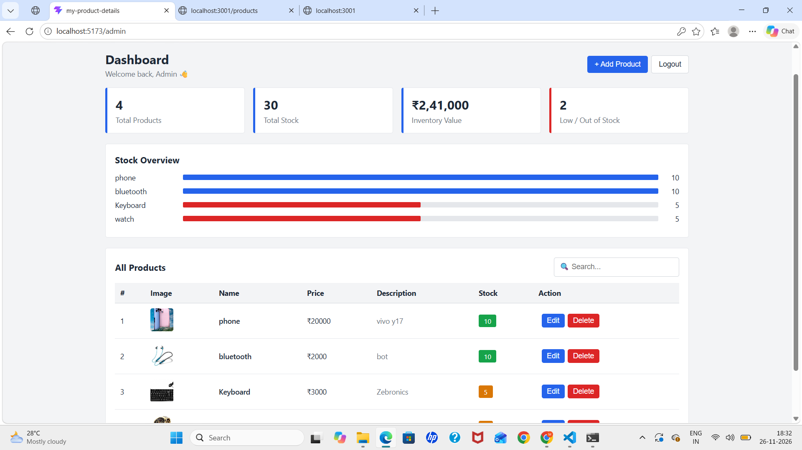
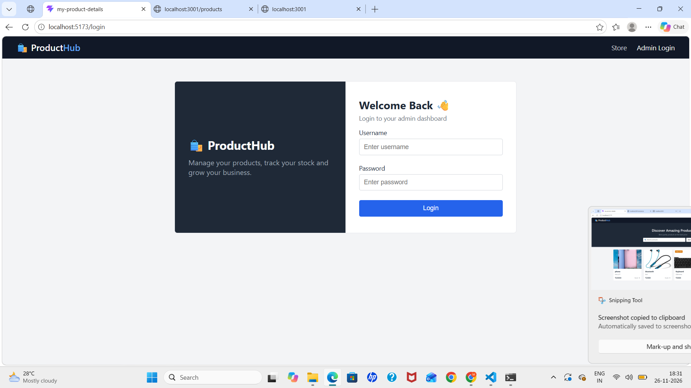

<<<<<<< HEAD
# Product Hub

A product management web app built with React. Users can browse products, and the admin can log in to add, update and delete products.

## Features
- Product cards with search and sort
- Admin login (protected route)
- Admin dashboard with stock stats and product table
- Add / Edit / Delete products (CRUD)

## Tech Stack
- React (Vite), React Router
- Axios
- json-server (fake REST API)

## How to run
1. Clone the repo
2. `npm install`
3. Terminal 1: `npx json-server@0.17.4 --watch db.json --port 3001`
4. Terminal 2: `npm run dev`

Admin login: `admin` / `admin123`

## Note
Login is client-side only (demo purpose). A real project needs backend authentication.
echo. >> README.md
echo. >> README.md
echo ## Screenshots >> README.md
echo. >> README.md
echo  >> README.md
echo. >> README.md
echo  >> README.md
echo. >> README.md
echo  >> README.md
=======
# Product-Hub
>>>>>>> 4ee32e6b95c099522c5471d85688c62c24c15b0e
